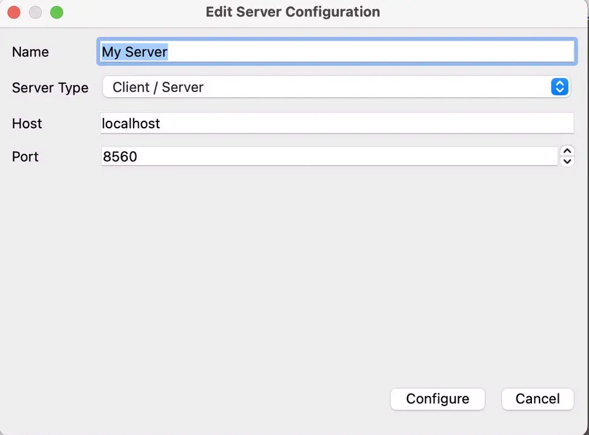
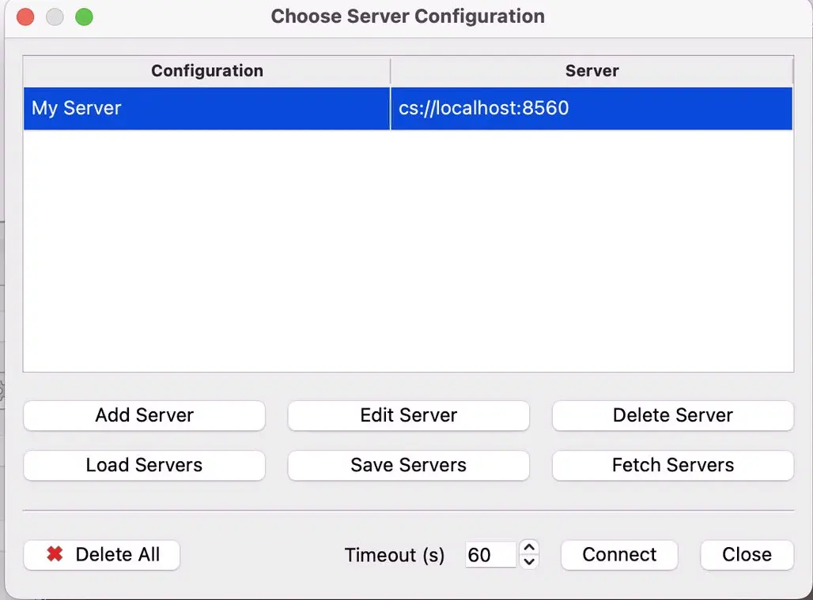
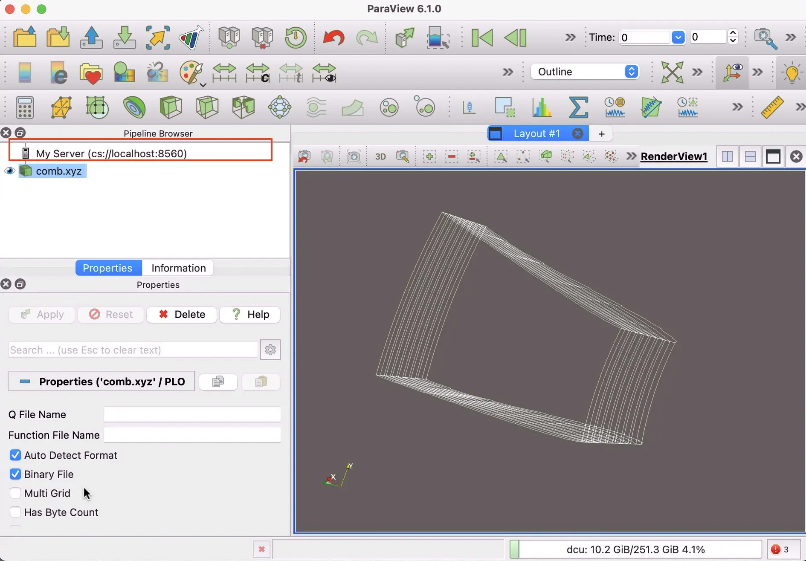

## 安装（服务端，基于 Spack）

```bash
mkdir /public/software/apps/paraview/
cd /public/software/apps/paraview/
wget wget https://www.paraview.org/paraview-downloads/download.php?submit=Download&version=v6.1&type=binary&os=Linux&downloadFile=ParaView-6.1.0-MPI-Linux-Python3.12-x86_64.tar.gz -O ParaView-6.1.0-MPI-Linux-Python3.12-x86_64.tar.gz
tar zxvf ParaView-6.1.0-MPI-Linux-Python3.12-x86_64.tar.gz
ln -s ParaView-6.1.0-MPI-Linux-Python3.12-x86_64/ 6.1.0
``` 

打开 spack 的 package.yaml 文件，写入以下内容：
```yaml
# packages.yaml
packages:
  paraview:
    externals:
    - spec: "paraview@6.1.0" # +mpi +python
      prefix: /public/software/apps/paraview/6.1.0
    buildable: false
```
然后：
```bash
spack install paraview
```

## 使用（服务端）
```bash
spack load paraview
mpiexec -np 8 pvserver --force-offscreen-rendering --server-port=8560
```
会出现如下的日志：
```log
Waiting for client...
Connection URL: cs://node-dcu:8560
Accepting connection(s): node-dcu:8560
```

## 使用（客户端）

:::note
客户端的 paraview 版本必须严格和服务端的paraview 版本保持一致。
:::

### ssh 隧道设置
本地的客户端（如你的 Windows上）下载安装paraview后，先打开 ssh 隧道（因为 服务端的服务器并没有开放8560端口，建议通过ssh隧道连接）:
```bash
# 这里，将本地的8560端口，映射为远程服务器的 8560 端口
# 用户名和远程的主机名（如：dcu.ssh.hpcer.dev，duc-node）注意替换
ssh -L 8560:dcu.ssh.hpcer.dev:8560 -N username@dcu-node
```

### 连接
1. 在顶部菜单栏点击 File -> Connect（或者点击工具栏上的插头图标）。

2. 在弹出的 “Choose Server Configuration” 窗口中，点击 Add Server。
按如下配置填写服务器信息：
- Name: My Server (随便起个名字)
- Server Type: Client / Server
- Host: 127.0.0.1 (因为使用了 SSH 隧道，所以这里填 localhost 或者 127.0.0.1，而不是服务器地址)
- Port: 8560

  

3. 点击 Configure，然后在弹出的选项框中将 “Startup Type” 保持为 Manual，点击 Save。

4. 回到服务器列表，双击你刚刚创建的“My Server”即可连接。
  

5. 验证连接： 连接成功后，ParaView 左侧的 Pipeline Browser 顶部的图标会由内置的 builtin 变成 cs://localhost:8560。此时，当你点击 File -> Open 时，你浏览和加载的将是 Linux 服务器上的硬盘目录。
  

## 用多节点进行分布式可视化
按道理，上面用 mpiexec 跑起来了 paraview，那么就可以跨节点用mpiexec 跑 paraview。

**留个坑，待实践**
TODO： 分布式可视化
